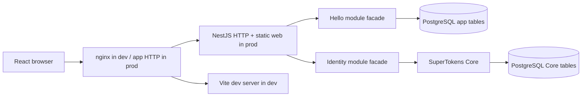

# Technical Specification — NestJS/React Starter

- **Feature ID:** `starter-project`
- **Source:** Direct user requirements
- **Author:** Engineer
- **Date:** `2026-09-27`
- **Status:** Draft

## 1. Outcome And Scope

### Required behavior

- **FR1:** Anonymous visitors see a greeting whose message is read from PostgreSQL.
- **FR2:** A visitor can sign up with full name, email, and password, sign in and out using SuperTokens React UI, and see `Hello <full name>` with the same database message after authentication.
- **FR3:** Liveness and readiness endpoints expose whether the application can serve traffic. Development serves Swagger UI; production does not register its routes.
- **FR4:** The complete system runs in hot-reloading development Compose and a two-service production test Compose (`app`, `pg`).

### Essential constraints

- npm workspaces with `apps/api`, `apps/web`, and `packages/shared`; TypeScript throughout. NestJS is a modular monolith with deep, hexagonal modules, public barrel exports, and exclusive module ownership of persistence. React TSX uses immutable data and function components; the backend owns product rules.
- PostgreSQL via Drizzle; SuperTokens Core owns credential/session data. Development has PostgreSQL, Core, API, web, and nginx containers. One production application image contains API, compiled web assets, and Core; PostgreSQL stays separate.
- Only module public facades cross module boundaries. Controllers, domain services, ports, gateway implementations, and table schemas remain private to their owning module.

### Out of scope

- Email verification, password recovery email delivery, social login, tenants, account administration, cron jobs, metrics, and a deployment platform. Use Nest's `@nestjs/schedule` only if a later feature needs scheduled work.

### Assumptions

- Single tenant; email/password login; full name is a display field, not a login identifier or globally unique handle. These choices are reversible because the greeting contract carries a display string, not an account key.
- The greeting is one seeded, editable-in-DB row with no management UI. The public endpoint remains read-only.
- The production Compose is a local production-mode smoke environment. External production ingress supplies TLS and forwards to the app HTTP port.

## 2. Existing Context

- Repository currently contains the `r3nd` workflow/template and `.gitignore`, but no application, package manifest, lockfile, CI, containers, deployed consumers, or stored data. This is a new private interface; no compatibility shim is needed.
- `r3nd/templates/tech_spec.md` supplies this document structure. No existing runtime, auth, validation, logging, or migration conventions need preservation.

## 3. Reuse And Dependency Decisions

Use compatible, pinned releases in `package-lock.json` and immutable base/Core image references. Confirm the chosen SuperTokens Core, PostgreSQL, Node, and SDK version matrix during implementation before fixing image digests.

| Concern                        | Existing capability inspected | Selected package or tool                                                                                                                                       | Custom code boundary and rationale                                                                                                                                                                                                                                                                             |
| ------------------------------ | ----------------------------- | -------------------------------------------------------------------------------------------------------------------------------------------------------------- | -------------------------------------------------------------------------------------------------------------------------------------------------------------------------------------------------------------------------------------------------------------------------------------------------------------- |
| API and modules                | None                          | NestJS on its Express adapter; `@nestjs/serve-static` for production web assets                                                                                | Product modules, provider bindings, HTTP composition                                                                                                                                                                                                                                                           |
| Relational data and migrations | None                          | `drizzle-orm` + `pg`, with `drizzle-kit generate` and `drizzle-kit migrate`                                                                                    | Module-owned schema and repository gateways; no raw-query data layer or custom migration runner                                                                                                                                                                                                                |
| Authentication                 | None                          | Self-hosted SuperTokens Core, `supertokens-node`, `supertokens-auth-react` EmailPassword + Session recipes                                                     | Thin Nest Express middleware/guard adapter, signup full-name hook, public identity facade; no custom token or password logic. [SuperTokens quickstart](https://supertokens.com/docs/quickstart), [signup customization](https://supertokens.com/docs/authentication/email-password/customize-the-sign-up-form) |
| Validation and contracts       | None                          | Nest `ValidationPipe` + `class-validator` for API input; TypeScript DTOs and small pure response mappers in `packages/shared`                                  | Validate full name in SuperTokens backend recipe and any new API input at the boundary; no independent frontend business validation                                                                                                                                                                            |
| Frontend and styles            | None                          | React, Vite, React Router, Tailwind CSS v4 with `@tailwindcss/vite`                                                                                            | Pure presentation components and request adapters. Put design tokens and source registration in `apps/web/src/styles/theme.css` using `@theme`; this is v4's explicit, thorough configuration file. [Tailwind theme docs](https://tailwindcss.com/docs/theme)                                                  |
| API docs and scheduling        | None                          | `@nestjs/swagger` in development; Nest `@nestjs/schedule` only when needed                                                                                     | Conditional Swagger registration; no scheduler in this slice                                                                                                                                                                                                                                                   |
| Quality and tests              | None                          | ESLint flat config with TypeScript ESLint, `eslint-plugin-react-hooks`, `eslint-plugin-react`, Prettier, Nest/Jest unit tests, Vitest for pure shared/web code | Root npm scripts; no duplicate formatter or test framework for the same target                                                                                                                                                                                                                                 |
| Container supervision          | None                          | Multi-stage Docker build and a minimal init/supervisor such as `s6-overlay` with a pinned release                                                              | Start/stop Nest and bundled Core, and terminate the container if either exits; one image, no bespoke daemon                                                                                                                                                                                                    |

Drizzle migrations own only application tables. SuperTokens Core owns and migrates its own tables; never introspect or modify them through Drizzle. The Core must use a persistent PostgreSQL connection and a private API key. Its official `/hello` endpoint is a basic process signal, not sufficient evidence of database or auth health. [Self-hosting guide](https://supertokens.com/docs/deployment/self-host-supertokens), [Drizzle migrations](https://orm.drizzle.team/docs/drizzle-kit-migrate).

## 4. Components And Contracts

Backend module shape: `modules/<name>/{domain,application,ports,adapters}` with `index.ts` exporting only the Nest module, facade, and public types/tokens. `HelloModule` owns its greeting table, repository port, Drizzle adapter, use case, and controller. `IdentityModule` owns SuperTokens integration, the identity facade, full-name profile table, and its repository. Infrastructure creates the shared Drizzle connection but exports no module table. Cross-module calls use injected public facades; even joins across another module's tables are forbidden.

| Boundary                    | Contract                                                                                                                                                                    | Owner                                      |
| --------------------------- | --------------------------------------------------------------------------------------------------------------------------------------------------------------------------- | ------------------------------------------ |
| Browser → API               | `GET /api/hello` → `{ message: string }` (public); `GET /api/hello/personal` → `{ fullName: string, message: string }` (session required, 401 otherwise)                    | Hello HTTP adapter; DTOs in shared package |
| Browser → auth API          | SuperTokens SDK routes at `/auth` for signup, login, session refresh, and logout; browser uses prebuilt React auth components on same origin                                | Identity module and SuperTokens SDK        |
| Hello → Identity            | `IdentityFacade.getFullNameForSession(userId)` → full name or an explicit missing-profile error; no direct identity table/Core access                                       | Identity module                            |
| Hello → persistence         | `GreetingRepository.getCurrent()` → immutable greeting value; one seeded row with stable key `default`                                                                      | Hello module                               |
| Identity → persistence/Core | `UserProfileRepository` maps SuperTokens user ID to validated full name; SuperTokens SDK handles account/session operations                                                 | Identity module/Core respectively          |
| Probe → app                 | `GET /health/live` (process serving) and `GET /health/ready` (app DB query + Core reachability and authenticated SDK operation or equivalent Core-backed probe); 200 or 503 | API composition/infrastructure             |

`packages/shared` contains transport DTO types and pure formatting/helpers only. It imports neither Nest, React, Drizzle, nor SuperTokens. Frontend folders use `features/<feature>/{pages,components,api}` plus `components/ui` for reusable buttons/navigation. One PascalCase component per `.tsx` file; hooks are `useCamelCase.ts`, pure helpers `camelCase.ts`, and feature/public `index.ts` barrels. React components do not use application state stores or domain decisions. SDK session state, route navigation, and local request loading/error state are permitted because React and SuperTokens need UI state; all business data comes from API responses and is treated immutably.

## 5. Minimum Production Baseline

| Concern                | Decision and minimum implementation                                                                                                                                                                                                                                                                                                                                                                                                                                                                                                                                                                                                                                           |
| ---------------------- | ----------------------------------------------------------------------------------------------------------------------------------------------------------------------------------------------------------------------------------------------------------------------------------------------------------------------------------------------------------------------------------------------------------------------------------------------------------------------------------------------------------------------------------------------------------------------------------------------------------------------------------------------------------------------------- |
| CI                     | Add one workflow: `npm ci`, lint, format check, typecheck, focused unit/boundary tests, workspace builds, and production image build. No secrets; use disposable PostgreSQL/Core only for the auth boundary check.                                                                                                                                                                                                                                                                                                                                                                                                                                                            |
| Runtime and config     | Dev Compose has five named services, nginx as sole published HTTP ingress, source bind mounts with dependency volumes and Vite/Nest watch mode, and a shared same-origin `/api` and `/auth` route. Production multi-stage image builds web/API, copies only runtime dependencies, built assets, and a verified Core distribution; run as non-root where Core's chosen distribution permits. Production Compose has exactly `app` and `pg`, a persistent PG volume, and healthcheck/restart policy. Expose only app HTTP; Core binds loopback inside `app`. Use `.env.example`; inject DB credentials, Core API key, domains, and mode at runtime. Validate config at startup. |
| Security               | Core is never browser-reachable; use an API key even on private networks. Nest handles `/auth` before routes and SuperTokens errors after routes; protect the personal endpoint server-side, validate and normalize full-name length/characters, avoid leaking secrets or raw DB errors, and use same-origin cookies with secure settings behind TLS. Disable Swagger route registration in production. No production secrets in image, source, or logs.                                                                                                                                                                                                                      |
| Identity and tenancy   | Public message, authenticated personal greeting; no tenant scope. Trust only verified SuperTokens session user ID, never a client-provided user ID or full name for personalization.                                                                                                                                                                                                                                                                                                                                                                                                                                                                                          |
| Compatibility and data | No existing consumers/data. Commit additive initial Drizzle migration and deterministic seed for the greeting row; Core manages its own schema. Run app migration as an explicit release step before readiness, then start Core and API. Keep previous image and database backup for rollback; do not automatically reverse applied migrations.                                                                                                                                                                                                                                                                                                                               |
| Operability            | JSON lifecycle/error logs to stdout with request ID; avoid credentials and auth headers. `/health/live` is cheap; `/health/ready` fails when app DB, Core, or required auth storage is unavailable. Container healthcheck calls readiness, but an exited Nest/Core process terminates the supervised container promptly so Compose `restart: unless-stopped` can act. Shutdown forwards signals and closes Nest/DB/Core gracefully. No metrics platform for this starter.                                                                                                                                                                                                     |

## 6. Non-Obvious Implementation Details

- **Signup state:** Add `fullName` to the prebuilt SuperTokens signup form and backend recipe. On successful Core signup, the Identity module writes `(supertokens_user_id, full_name)` through its repository with a unique user ID. The hook must return an error and compensate by deleting the newly created Core user if profile persistence fails; test this path. A failure to compensate is logged with a request ID and leaves the account unusable until repaired. Never return a successful signup without a stored full name. [SuperTokens custom fields](https://supertokens.com/docs/authentication/email-password/customize-the-sign-up-form).
- **Message lifecycle:** The initial migration creates `hello_messages` with a stable `default` key and non-null text; a deterministic seed inserts `Hello world` only if absent. Both greeting endpoints read the same repository method on every request. Missing row or DB outage returns a safe 503 and makes readiness fail.
- **Core packaging:** The production image includes the official Core distribution pinned to a compatible release/checksum and the runtime libraries it needs. Prove startup in a built-image smoke before treating the design as complete. Keep Core's PostgreSQL URL in the `postgresql://` form required by its docs. A minimal supervisor treats either child exit as failure; readiness includes Core and DB checks, while liveness does not restart the app for brief dependency outages. [Self-hosting guide](https://supertokens.com/docs/deployment/self-host-supertokens).
- **Route/config behavior:** Development nginx proxies `/api` and `/auth` to Nest and everything else to Vite; production Nest serves Vite's compiled assets and falls back to `index.html` only for browser routes, never `/api`, `/auth`, `/health`, or Swagger. Configure the same public origin in both SuperTokens SDKs. Swagger is initialized only when `NODE_ENV=development`, with its JSON document disabled in production too.
- **Tailwind configuration:** `theme.css` defines semantic colors, typography, spacing, radii, shadows, breakpoints, dark-mode variant, and content source rules with comments and example use. Keep these tokens in one file; Tailwind v4 JavaScript configuration is only a compatibility path and is not needed here. [Tailwind v4 theme](https://tailwindcss.com/docs/theme), [upgrade guide](https://tailwindcss.com/docs/upgrade-guide).
- **Production size:** Use lockfile installs, builder stages, `.dockerignore`, static web output, and a slim runtime base compatible with both Node and Core. Do not retain compilers, source mounts, or dev dependencies in runtime. Measure and document final image size and startup time during implementation; Core imposes a lower bound on both.

## 7. Verification

- **Unit:** Hello use case uses its repository and identity facade; test public/personal output, missing message, and missing/unauthorized session. Test full-name validation and signup profile-write failure compensation through Identity public behavior.
- **Boundary/contract:** One container-backed auth/persistence test with PostgreSQL and Core proves signup with full name, session-protected greeting, logout/401, and Core failure causing readiness 503. Keep it focused on the production-risk boundary.
- **CI:** `npm ci`, `npm run lint`, `npm run format:check`, `npm run typecheck`, `npm test`, `npm run build`, and `docker build` for the production target; run the focused boundary check in its disposable environment.
- **Runtime smoke:** `docker compose -f compose.dev.yml up --build`: edit API/web source and observe changes without rebuilding; verify public greeting, auth flow, health, and dev Swagger. `docker compose -f compose.prod.yml up --build`: verify exactly two services, static web, the same flow, readiness, absent Swagger, and app unhealthy/restarted when either supervised child exits. Inspect image size/startup and confirm no Core port is published.
- **Optional QA candidates:** Manual browser signup/login/logout and greeting, unauthenticated 401, code-change feedback, and Core/DB outage behavior.
- **QA choice:** Ask after implementation; do not decide in this spec.

## 8. Tasks

### T1 — Workspace and delivery shell

- **Outcome:** Installable workspace, shared contracts, lint/format/typecheck/build scripts, dev/prod container skeletons, and CI.
- **Scope:** npm lockfile, `apps/*`, `packages/shared`, TypeScript/ESLint/Prettier, Compose, Dockerfile, nginx dev config, environment example.
- **Depends on:** None.
- **Consumes/Exposes:** Workspace build and shared DTO imports.
- **Production baseline:** Locked dependencies, small image strategy, config validation, non-secret CI.
- **Acceptance:** `npm ci` and workspace quality/build commands pass; Compose service graph and image build are valid.

### T2 — Backend modules and data

- **Outcome:** Public/personal greeting and operational probes backed by PostgreSQL.
- **Scope:** Deep Hello and Identity modules, ports/adapters/facades, Drizzle connection/migration/seed, API contracts, readiness/liveness, dev-only Swagger.
- **Depends on:** T1.
- **Consumes/Exposes:** Shared greeting DTOs and API routes.
- **Production baseline:** Data ownership, validation, logs, request ID, safe failures, migration step.
- **Acceptance:** Focused unit tests and DB boundary checks; same stored message in both routes.

### T3 — SuperTokens and web flow

- **Outcome:** Working signup/login/logout and personalized React page in both runtimes.
- **Scope:** SuperTokens Core packaging and SDK integration, full-name hook/profile, React feature/page/ui components, Tailwind theme, ingress/static routing, supervised process and health behavior.
- **Depends on:** T1 and T2.
- **Consumes/Exposes:** `/auth`, `/api/hello`, `/api/hello/personal`, health endpoints.
- **Production baseline:** Session authorization, Core secrecy, child-process restart behavior, production image smoke and rollback notes.
- **Acceptance:** Focused auth boundary test, dev hot reload, production two-service smoke, no production Swagger.

## 9. Blocking Questions

- None. The assumptions above keep the initial interface and identity model reversible.
